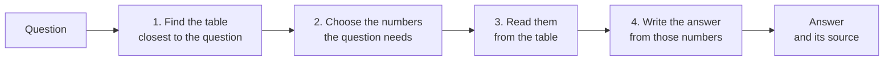

# gagnvist

**A starter kit for the GAGNVÍST 2026 hackathon: answer questions about Iceland, in
Icelandic or English, from the official tables of Statistics Iceland.**

```console
$ gagnvist ask "How many people live in Reykjavík?"
```

The starter kit gives every team the same working system to begin with. It is
deliberately simple, so that you can read all of it, and every part of it is a place to
make it better: the search, the prompts, the models, the embeddings. Your job is to find
out what works best.

- [Get started](#get-started)
- [How it works](#how-it-works)
- [Commands](#commands)
- [Making it better](#making-it-better)
- [Using it from Python](#using-it-from-python)
- [What is where](#what-is-where)
- [For developers](#for-developers)
- [Data and licences](#data-and-licences)

## Get started

Follow the guide for your computer. Each goes step by step from nothing to your first
answer, in about 20 minutes plus a download of about 300 MB:

- **[Setting up on a Mac](docs/setup-mac.md)**
- **[Setting up on Windows](docs/setup-windows.md)**
- On Linux, follow the Mac guide, with three differences: install git, Python 3.11 or
  newer with its venv module, and `openssh-client` from your package manager (on
  Ubuntu 22.04, whose `python3` is 3.10: `python3.11` and `python3.11-venv`, then
  `python3.11 -m venv .venv` in step 3); edit `.env` with any text editor (for
  example `nano .env`) instead of TextEdit; and if `gagnvist lumi check` says no SSH
  agent is running, start one in that terminal with `eval "$(ssh-agent)"`
  ([docs/lumi.md, section 3](docs/lumi.md#3-your-passphrase)).

Have these ready before you start:

| What | Where it comes from |
|---|---|
| Your LUMI username, and the SSH key you use for LUMI | your LUMI account: see [docs/lumi.md](docs/lumi.md#1-your-lumi-account) |
| Your team's key | the organizers give it to your team privately |
| If the organizers say the models also run on JURECA: your JuDoor username and the key you registered there | your JURECA account: see [docs/jureca.md](docs/jureca.md#1-your-jureca-account) |
| Access to this repository on GitHub | the organizers add your GitHub account |
| About 8 GB of free disk space | the unpacked data takes 5.7 GB, and unpacking needs room for the zip too |

Do the setup before the hackathon if you can: the download is slow on a busy network.

**Once set up, every day** is two terminal windows in the starter kit's folder, each
with its environment activated (your guide shows how):

```bash
gagnvist lumi connect                                  # window 1: the tunnel to LUMI; leave it open
gagnvist ask "How many people live in Reykjavík?"      # window 2
```

```text
In 2026, the total population of Reykjavík is 139,804.

Source: Statistics Iceland, table MAN03270 "Population in Reykjavík by districts, sex and age 1 January 1998-2026" (updated 2026-03-12): https://px.hagstofa.is/pxen/api/v1/en/Ibuar/mannfjoldi/2_byggdir/Byggdakjarnarhverfi/MAN03270.px
Numbers used:
  Districts: Total; Age: Total; Year: 2026; Sex: Total = 139804
```

The model words its answer in its own way; the source and the numbers come from the
program. Questions in Icelandic are answered in Icelandic, from the Icelandic tables.
Add `--show-steps` to see the tables the search found and the choices the program
corrected.

Not every answer is right: the starter kit is a simple first version, and
`gagnvist evaluate` counts how many of its answers are right. Raising that number is
what the hackathon is about (see [Making it better](#making-it-better)).

Your SSH key's passphrase: `gagnvist lumi check` and `connect` offer to remember it, so
that you type it only once: on macOS and Linux for as long as you choose (at most 7
days), on Windows until you remove it (see [docs/lumi.md](docs/lumi.md#3-your-passphrase)).

> **Your settings stay on your computer.** Your personal settings go in `.env`, which
> git ignores, as it ignores key files: they are never committed or pushed; the name
> and meaning of every setting are in `example.env`. The shared settings, the same for
> everyone, are in `gagnvist.toml`, which comes with the code. Never put a key anywhere
> else in the repository. Your SSH key is yours alone, not even for your teammates;
> your team key is for your team only.

## How it works



1. **Find the table.** Every table has a short description, its *card*: its title and
   the names of its dimensions. The cards were turned into vectors by an embedding
   model, once. The question is turned into a vector by the same model, and the table
   whose card is closest is used.
2. **Choose the numbers.** A table holds one number for every combination of
   *categories* (2024, Females, Reykjavík, ...). A language model reads the question
   and the table's categories, and chooses the ones the question needs. The program
   then checks every choice against the table.
3. **Read them.** The numbers are read from the table's data file. No model touches
   them: they are exactly what Statistics Iceland published.
4. **Write the answer.** The language model writes a short answer from those numbers
   only. The program adds the source, and points out any number in the answer that the
   table did not give.

The models run on [LUMI](https://www.lumi-supercomputer.eu/), the supercomputer in
Kajaani, Finland. The organizers run a shared chat model and a shared embedding model
for everyone; you can also run models of your own there. When the organizers say so,
the same two models also run on [JURECA](https://apps.fz-juelich.de/jsc/hps/jureca/) in
Jülich, Germany, so that one supercomputer can stand in for the other: the same
commands, with `jureca` in place of `lumi`, and `--cluster jureca` (or
`GAGNVIST_CLUSTER=jureca` in `.env`) to send your questions there (see
[docs/jureca.md](docs/jureca.md)). The tables themselves are on
your computer. [docs/how-it-works.md](docs/how-it-works.md) explains every step in
detail.

## Commands

| Command | What it does |
|---|---|
| `gagnvist get-data` | unpack the data that comes with the repository, and check every file |
| `gagnvist check-data` | check the data again, file by file |
| `gagnvist build-index` | build the local database of table descriptions |
| `gagnvist ask "..."` | answer a question |
| `gagnvist find-tables "..."` | only search: the tables closest to a question |
| `gagnvist evaluate` | answer questions with known answers, and show which answers are right and why the others are not |
| `gagnvist try-models` | send one small request to each model |
| `gagnvist build-cards` | write every table's card, in both languages, into `cards/` (they come with the repository; `--replace` writes them again) |
| `gagnvist build-vectors` | embed the text of every card in `cards/` into a new vector index |
| `gagnvist lumi ...` | the tunnel to the shared models, and models of your own: see [docs/lumi.md](docs/lumi.md) |
| `gagnvist jureca ...` | the same on JURECA, the second supercomputer: see [docs/jureca.md](docs/jureca.md) |

Every command has `--help`. The commands that use the models (`ask`, `evaluate`,
`find-tables`, `try-models`, `build-vectors`) take `--cluster lumi` or `--cluster
jureca` to say whose shared models to use; without it, `GAGNVIST_CLUSTER` in `.env`
decides, and without that, LUMI.

## Making it better

Start by measuring. `gagnvist evaluate` asks the questions in
[questions/examples.jsonl](questions/examples.jsonl), whose answers are known: 26
questions, each in English and Icelandic, at three levels. `easy` needs one number from
one table, `medium` a calculation with several numbers from the same table, `hard`
numbers from two different tables. For each question it prints `right` or `WRONG` (or
`other table`: the right number from a table that does not hold it), the table the
answer came from and the expected number; then the right answers by level and language,
and, for every answer that is not right, what was expected and why it is not right.
`--language is` or `en` and `--level easy` (or `medium`, `hard`) pick a part of the
questions. Every answer is saved in `local/evaluations/`, so that two runs can be
compared.

Write questions of your own in the same form (see
[questions/README.md](questions/README.md)), and evaluate after every change.

Where to look first:

| To improve | Change | Read |
|---|---|---|
| which table is found | the cards, the embedding model, or the search itself | [cards/README.md](cards/README.md), [docs/re-embedding.md](docs/re-embedding.md), `answering/find_tables.py` |
| which numbers are chosen | the prompt, or how categories are shown | `models/prompts.py`, `answering/choose_categories.py` |
| how the answer is written | the prompt | `models/prompts.py`, `answering/write_answer.py` |
| the language model | a bigger or different model, or fine-tuning | [docs/lumi.md](docs/lumi.md) |

[docs/how-it-works.md](docs/how-it-works.md) lists known weak spots of the starter
kit, each a good place to begin. [docs/pxweb.md](docs/pxweb.md) explains how
Statistics Iceland's tables are built, which helps with most of them.

## Using it from Python

Everything the commands do can be done from your own code, which is where an app
starts. The pipeline answers a question and returns the answer together with what it
is based on:

```python
from pathlib import Path

from gagnvist.answering.pipeline import Pipeline
from gagnvist.config import load_settings

settings = load_settings(Path("gagnvist.toml"))  # and .env next to it
with Pipeline.from_settings(settings) as pipeline:
    answer = pipeline.answer("How many people live in Reykjavík?")

print(answer.text)                   # the model's answer
print(answer.source)                 # the table it comes from
for fact in answer.facts:            # the numbers it was written from
    print(fact.text)
print(answer.table.table_code, [m.card.folder for m in answer.candidates])
```

`answer.unsupported` and `answer.years_not_covered` hold the results of the two
checks. Each step can also be called on its own: see `answering/pipeline.py`.

## What is where

```text
gagnvist.toml            shared settings, the same for everyone
example.env              personal settings: copy to .env, which is never committed
src/gagnvist/
    cli.py               the gagnvist command
    config.py            reading gagnvist.toml and .env
    cards.py             the table cards: gagnvist build-cards
    data/                the data: downloading, the catalogue, reading data.px files
    search/              the table database, and the vector search over the cards
    models/              talking to the models (client.py), and every prompt (prompts.py)
    answering/           the four steps: find_tables, choose_categories,
                         read_numbers, write_answer, joined in pipeline.py
    evaluate.py          gagnvist evaluate
    lumi/                the supercomputers: ssh, tunnels, your own jobs, and the job
                         scripts (written for LUMI; the same code serves JURECA)
    clusters/            what differs between LUMI and JURECA: one profile each
data-release/            the data, zipped (in pieces, as GitHub refuses large files)
data/                    the data, unpacked by gagnvist get-data (not in git)
local/                   made on your computer: the table database, saved evaluations,
                         your own cards and indexes (not in git)
questions/               questions with known answers
cards/                   every table's card, in Icelandic and English: titles, dimensions,
                         categories, periods (see cards/README.md)
index/                   the vector index of the table cards (shipped by the organizers)
docs/                    setup guides (Mac, Windows), how it works, the data, LUMI, JURECA
tests/                   the tests, a miniature copy of the data, and stand-ins for
                         the models and for LUMI
```

## For developers

Only if you change the code and want to check that nothing broke. The tests need no
network, no LUMI and no models:

```bash
pip install -e ".[dev]"
pytest
ruff check src tests
ruff format --check src tests
mypy
```

The tests use a miniature copy of the data (`tests/fixtures/`), a fake LUMI
(`tests/fake_lumi.py`), and a stand-in for the model servers (`tests/standin.py`). The
stand-in is not a model: it imitates one with simple word matching and repeats the
numbers it is given, so that the tests can check the program's own steps. Real answers
come from the models on LUMI.

## Data and licences

The data is published by [Statistics Iceland](https://www.hagstofa.is/) (Hagstofa
Íslands) under the [Creative Commons Attribution 4.0](https://creativecommons.org/licenses/by/4.0/)
licence: use it freely, and name Statistics Iceland as its source, as `gagnvist ask`
does. The data release contains the tables that are published in both Icelandic and
English, as they were on 18 October 2026; its own README lists the tables left out and
why (five corrections to that README are in [docs/pxweb.md](docs/pxweb.md#corrections-to-the-datas-own-readme)).
