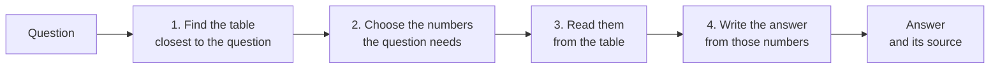

# gagnvist

**A starter kit for the GAGNVÍST 2026 hackathon: answer questions about Iceland, in
Icelandic or English, from the official tables of Statistics Iceland.**

```console
$ gagnvist ask "How many people live in Reykjavík?"
```

The starter kit gives every team the same working system to begin with. It is
deliberately simple, so that you can read all of it, and every part of it is a place to
make it better: the search, the prompts, the models, the embeddings. Your job is to find
out what works best.

- [How it works](#how-it-works)
- [Quick start](#quick-start)
- [Commands](#commands)
- [Making it better](#making-it-better)
- [Using it from Python](#using-it-from-python)
- [What is where](#what-is-where)
- [For developers](#for-developers)
- [Data and licences](#data-and-licences)

## How it works



1. **Find the table.** Every table has a short description, its *card*: its title and
   the names of its dimensions. The cards were turned into vectors by an embedding
   model, once. The question is turned into a vector by the same model, and the table
   whose card is closest is used.
2. **Choose the numbers.** A table holds one number for every combination of
   *categories* (2024, Females, Reykjavík, ...). A language model reads the question
   and the table's categories, and chooses the ones the question needs. The program
   then checks every choice against the table.
3. **Read them.** The numbers are read from the table's data file. No model touches
   them: they are exactly what Statistics Iceland published.
4. **Write the answer.** The language model writes a short answer from those numbers
   only. The program adds the source, and points out any number in the answer that the
   table did not give.

The models run on [LUMI](https://www.lumi-supercomputer.eu/), the supercomputer in
Kajaani, Finland. The organizers run a shared chat model and a shared embedding model
for everyone; you can also run models of your own there. The tables themselves are on
your computer. [docs/how-it-works.md](docs/how-it-works.md) explains every step in
detail.

## Quick start

You need Python 3.11 or newer, git, and an SSH client (included with macOS, Linux and
Windows 10 or later). Before the hackathon you also get a LUMI account and your team's
key: see [docs/lumi.md](docs/lumi.md).

**1. Install**

```bash
git clone https://github.com/SyedMuhammadAzhar/gagnvist-starter.git
cd gagnvist-starter
python3 -m venv .venv              # Windows: py -m venv .venv
source .venv/bin/activate          # Windows: .venv\Scripts\activate
pip install -e .
```

**2. Fill in your settings.** Copy `example.env` to `.env` and fill in its three
values: your LUMI username, the path to your own SSH key for LUMI, and your team's key.

```bash
cp example.env .env                # Windows: copy example.env .env
```

> **Your settings stay on your computer.** Your personal settings go in `.env`, which
> git ignores, as it ignores key files: they are never committed or pushed. The shared
> settings, the same for everyone, are in `gagnvist.toml`, which comes with the code.
> Never put a key anywhere else in the repository. Your SSH key is yours alone, not
> even for your teammates; your team key is for your team only.

**3. Get the data** (about 250 MB to download, 5.4 GB unpacked; every file is checked):

```bash
gagnvist get-data
gagnvist build-index
```

**4. Connect to the shared models,** and leave that terminal open:

```bash
gagnvist lumi check
gagnvist lumi connect
```

**5. Ask**, in a second terminal:

```console
$ gagnvist ask "How many people live in Reykjavík?"
<the model's answer, in a sentence or two>

Source: Statistics Iceland, table MAN02005 "Population by municipality, age and sex 1998-2026 - Division into municipalites as of 1 January 2026" (updated 2026-03-12): https://px.hagstofa.is/pxen/api/v1/en/Ibuar/mannfjoldi/2_byggdir/sveitarfelog/MAN02005.px
Numbers used:
  Municipality: Reykjavikurborg; Age: Total; Year: 2026; Sex: Total = 139804
```

Questions in Icelandic are answered in Icelandic, from the Icelandic tables:
`gagnvist ask "Hve margir búa í Reykjavík?"`. Add `--show-steps` to see the tables the
search found and the choices the program corrected.

## Commands

| Command | What it does |
|---|---|
| `gagnvist get-data` | download the data, unpack it and check every file |
| `gagnvist check-data` | check the data again, file by file |
| `gagnvist build-index` | build the local database of table descriptions |
| `gagnvist ask "..."` | answer a question |
| `gagnvist find-tables "..."` | only search: the tables closest to a question |
| `gagnvist evaluate` | answer questions with known answers and count the right ones |
| `gagnvist try-models` | send one small request to each model |
| `gagnvist build-vectors` | embed every table's card into a new vector index |
| `gagnvist lumi ...` | the tunnel to the shared models, and models of your own: see [docs/lumi.md](docs/lumi.md) |

Every command has `--help`.

## Making it better

Start by measuring. `gagnvist evaluate` asks the questions in
[questions/examples.jsonl](questions/examples.jsonl), whose answers are known: for each
one it prints `right` or `WRONG`, the table the answer came from (and the expected one,
if they differ) and the expected number; at the end, how many answers were right, and
how many came from the right table. Every answer is saved in `local/evaluations/`, so
that two runs can be compared.

Write questions of your own in the same form (see
[questions/README.md](questions/README.md)), and evaluate after every change.

Where to look first:

| To improve | Change | Read |
|---|---|---|
| which table is found | the cards, the embedding model, or the search itself | [docs/re-embedding.md](docs/re-embedding.md), `answering/find_tables.py` |
| which numbers are chosen | the prompt, or how categories are shown | `models/prompts.py`, `answering/choose_categories.py` |
| how the answer is written | the prompt | `models/prompts.py`, `answering/write_answer.py` |
| the language model | a bigger or different model, or fine-tuning | [docs/lumi.md](docs/lumi.md) |

[docs/how-it-works.md](docs/how-it-works.md) lists known weak spots of the starter
kit, each a good place to begin. [docs/pxweb.md](docs/pxweb.md) explains how
Statistics Iceland's tables are built, which helps with most of them.

## Using it from Python

Everything the commands do can be done from your own code, which is where an app
starts. The pipeline answers a question and returns the answer together with what it
is based on:

```python
from pathlib import Path

from gagnvist.answering.pipeline import Pipeline
from gagnvist.config import load_settings

settings = load_settings(Path("gagnvist.toml"))  # and .env next to it
with Pipeline.from_settings(settings) as pipeline:
    answer = pipeline.answer("How many people live in Reykjavík?")

print(answer.text)                   # the model's answer
print(answer.source)                 # the table it comes from
for fact in answer.facts:            # the numbers it was written from
    print(fact.text)
print(answer.table.table_code, [m.card.folder for m in answer.candidates])
```

`answer.unsupported` and `answer.years_not_covered` hold the results of the two
checks. Each step can also be called on its own: see `answering/pipeline.py`.

## What is where

```text
gagnvist.toml            shared settings, the same for everyone
example.env              personal settings: copy to .env, which is never committed
src/gagnvist/
    cli.py               the gagnvist command
    config.py            reading gagnvist.toml and .env
    data/                the data: downloading, the catalogue, reading data.px files
    search/              the table database, and the vector search over the cards
    models/              talking to the models (client.py), and every prompt (prompts.py)
    answering/           the four steps: find_tables, choose_categories,
                         read_numbers, write_answer, joined in pipeline.py
    evaluate.py          gagnvist evaluate
    lumi/                LUMI: ssh, tunnels, your own jobs, and the job scripts
questions/               questions with known answers
index/                   the vector index of the table cards (shipped by the organizers)
docs/                    how it works, the data, LUMI
tests/                   the tests, a miniature copy of the data, and stand-ins for
                         the models and for LUMI
```

## For developers

```bash
pip install -e ".[dev]"
pytest            # the tests: no network, no LUMI, no models needed
ruff check src tests && ruff format --check src tests
mypy
```

The tests run against a miniature copy of the data (`tests/fixtures/`), a stand-in for
the model servers (`tests/standin.py`) and a fake LUMI (`tests/fake_lumi.py`). The
stand-in can also run as a server, so that you can try the whole program without LUMI:
start `python tests/standin.py` (it listens where the tunnel would, on port 8765), put
`GAGNVIST_CHAT_MODEL=standin-chat` and `GAGNVIST_EMBEDDINGS_MODEL=standin-embeddings` in
`.env`, set `[search] index = "local/index-standin"` in `gagnvist.toml`, and run
`gagnvist build-vectors`. Its answers only repeat the numbers it is given.

## Data and licences

The data is published by [Statistics Iceland](https://www.hagstofa.is/) (Hagstofa
Íslands) under the [Creative Commons Attribution 4.0](https://creativecommons.org/licenses/by/4.0/)
licence: use it freely, and name Statistics Iceland as its source, as `gagnvist ask`
does. The data release contains the tables that are published in both Icelandic and
English, as they were on 18 October 2026; its own README lists the tables left out and
why.
